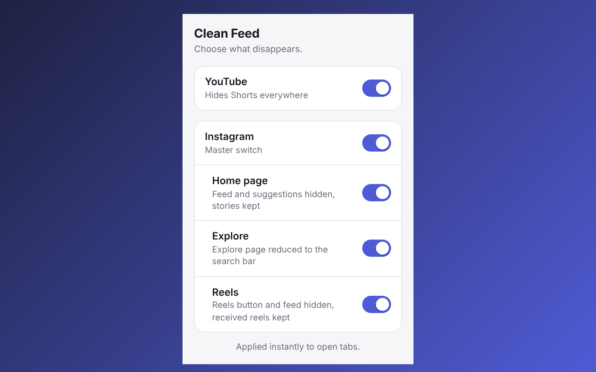

<div align="center">


[](LICENSE)


</div>

**Clean Feed** is a Firefox / Zen extension that removes the endless-scroll parts of YouTube and Instagram,
while keeping everything you actually use them for.

## What it does

| Toggle | Effect |
|---|---|
| **YouTube** | Hides Shorts (shelves, thumbnails, tabs, menu entry). `/shorts/` links open in the regular player. |
| **Instagram** (master) | Turns every Instagram option on or off at once. |
| ↳ **Home** | Hides the feed, "You're all caught up" and suggestions. Stories are kept (centered on desktop). |
| ↳ **Explore** | Reduces the Explore page to the search bar, with no loading spinner. |
| ↳ **Reels** | Hides the Reels button and redirects the Reels tab to the home page. |

The cleanup only applies to the Instagram **home** and **Explore** pages. Profiles, posts, hashtags,
places and direct messages are never touched: a reel sent to you in a message opens normally.

Everything is on by default and each toggle takes effect immediately on open tabs.

## Screenshot

<p align="center"></p>

One toolbar menu, one toggle per feature. The interface is available in English and French.

## Privacy

No data is collected, stored remotely or sent anywhere. The extension has no network code.
Settings are kept locally with `storage.local`. Access is limited to `instagram.com` and `youtube.com`.
On Instagram it also saves a single number (the horizontal offset used to center stories) in the page's
`localStorage`, per window width, to avoid a visual jump on load.

## Why Manifest V2?

In Firefox, Manifest V3 treats site access as an optional permission that the user has to grant by hand,
and it is lost on temporary installs. Manifest V2 grants the access at install time so the extension
works right away. Firefox still supports Manifest V2.

## Develop

```bash
npx web-ext run          # test in a temporary Firefox profile
npx web-ext lint
npx web-ext build        # produces web-ext-artifacts/*.zip
```

Plain JavaScript and CSS, no build step, nothing minified.

## If something comes back

Instagram and YouTube change their markup regularly. The rules live in `instagram.css`, `youtube.css`,
`instagram.js` (`MARKERS`: texts that trigger hiding of what follows) and `youtube.js`.
Open an issue with a screenshot.

## License

MIT
